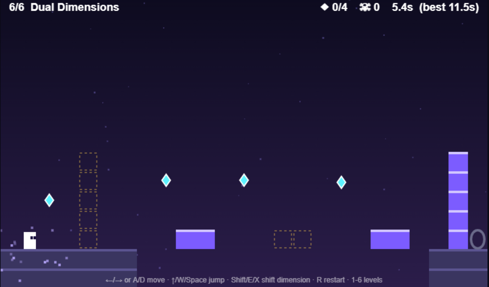

# 🌗 Dual Dimensions

A puzzle-platformer about two worlds that occupy the same space. Shift between **Light** and **Shadow**: platforms, walls and spikes exist in only one of them.

🎮 **Play now:** https://unknown07-cpu-sys.github.io/Dual-dimension/



## 🤖 Made entirely by AI

This game was designed and coded entirely by AI ([Claude](https://claude.ai) by Anthropic). The concept, mechanics, level design, code and docs all came out of prompts and iteration. The first prototype was a Phaser game, and the current version was redesigned from scratch.

## How to play

- Collect every ◆ shard, then enter the portal.
- Press **Shift** to swap dimensions. Blocks marked with a dashed outline exist in the *other* dimension.
- You can't shift if you'd end up inside a wall or on top of active spikes.
- Beat the par time for ★★★.

| Tile | Meaning |
|---|---|
| Gold block | Solid only in **Light** |
| Violet block | Solid only in **Shadow** |
| Red spikes | Deadly in both dimensions |
| Orange spikes | Deadly only in **Light** |
| Purple spikes | Deadly only in **Shadow** |

## Controls

| Action | Keyboard | Touch |
|---|---|---|
| Move | ←/→ or A/D | on-screen ◀ ▶ |
| Jump | ↑ / W / Space | ▲ |
| Shift dimension | Shift / E / X | ⇄ |
| Restart level | R | – |
| Pause | P | – |
| Mute | M | – |
| Level menu | Esc | ☰ |

## Features

- 10 handcrafted levels, with a level select and saved progress
- Star ratings and best times per level
- Two mechanics so far: dimension-locked blocks and dimension-locked spikes
- Synthesized music and sound effects that change with the dimension (no audio files)
- Works on desktop and mobile, with no dependencies and no build step

## Project structure

```
index.html     page shell
css/style.css  styling
js/levels.js   level data (ASCII maps, easy to edit)
js/game.js     engine: physics, rendering, menu, input
```

## Run locally

Open `index.html` in a browser, or run `python3 -m http.server` in this folder.

## Make your own level

Levels are plain text in `js/levels.js`. Each row is 25 characters, and rows are aligned to the bottom of a 25×15 grid.

```
#  ground          L  solid in Light      S  solid in Shadow
^  spikes          u  Light spikes        n  Shadow spikes
*  shard           G  portal              P  player start
```

## Roadmap

- [ ] In-browser level editor
- [ ] New mechanics (moving platforms, jump pads)
- [ ] More levels and a world 2 theme

## License

[MIT](LICENSE)
